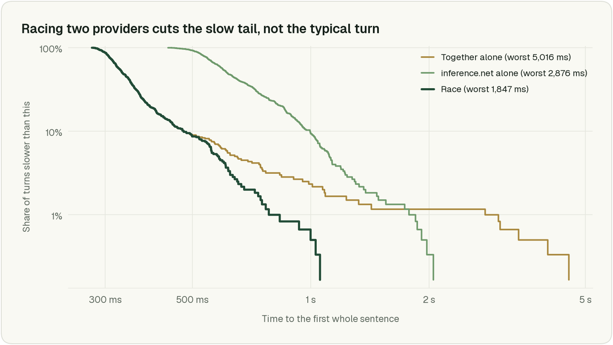
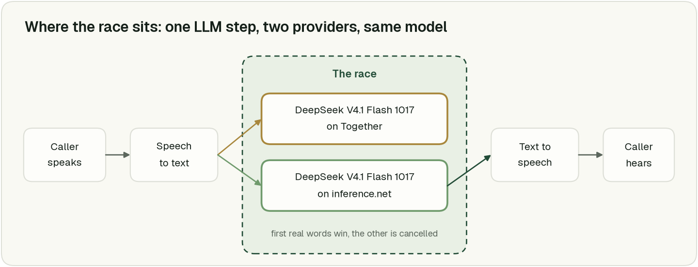
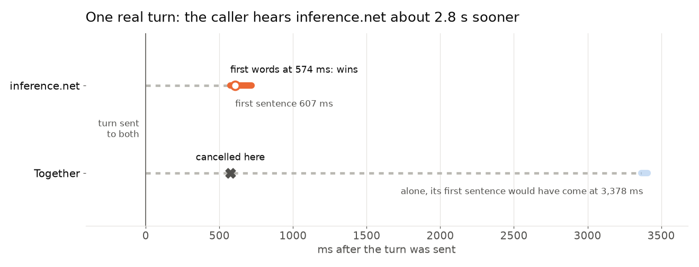
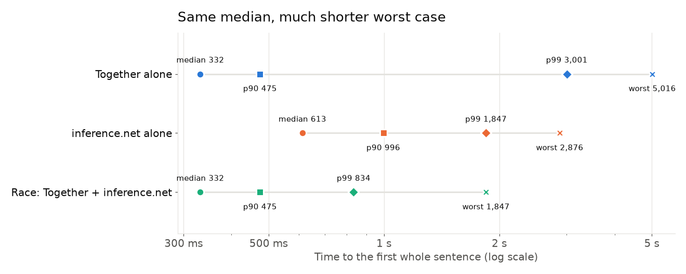
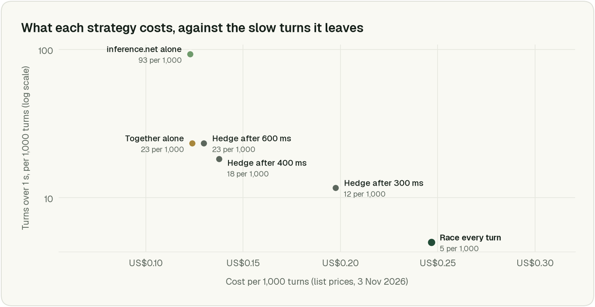

# Voice Agent Tail Latency: How Hedged Requests Cut Slow Turns by 7x

### I sent each voice-agent turn to the same model on two providers and kept whichever streamed first. I measured p50, p90 and p99, and what it costs.

People are very good at taking turns in conversation. A study of ten languages found speakers everywhere keep the silence between turns short ([Stivers et al., 2009](https://pubmed.ncbi.nlm.nih.gov/19553212/)), so when a voice agent goes quiet for a couple of seconds, people notice. I wanted to know how often the language model is behind those pauses, and whether a trick Google described in 2013 could fix it. So I measured DeepSeek V4.1 Flash, an open-weights model that's quick enough for voice, on two providers that serve it, [Together](https://www.together.ai/) and [inference.net](https://inference.net/). Even the quicker of the two took over a second to reach the first full sentence on 2.3% of turns, and its slowest took 5 seconds.

Then I sent every turn to both providers at once and kept whichever one started talking first. Turns over a second dropped from 2.3% to 0.3%, and the worst case went from 5.0 s to 1.7 s. The median barely moved, and it didn't need to, since a typical turn was already quick.


*Share of turns slower than a given time, 600 turns. Each step down the y axis is ten times rarer. The race (green) drops away long before either provider does on its own.*

## Why the slow turns matter more than the average

Two terms I'll use a lot:

- **Time to first token (TTFT)**, or time to first word: how long from sending the turn until the model starts replying.
- **p50, p90, p99**: the time that 50%, 90% and 99% of turns come in under. p50 is the median, the typical turn. p99 is the slowest 1 in 100.

In this article we care more about p90 and p99, the reason being because the median tells you little about the user experience with the voice agent. Even if the agent pauses awkwardly 1 out of 10 turns, the user already notices and is annoyed.

Imagine each conversation has 10 turns, and your p99 is 5 seconds, that means once every 10 calls, one callee gets a pause of 5 seconds, and that puts people off big time. The solution to this is hedged requests: the moment you notice an api is slow, you send it to another server/provider so your eggs aren't all in one basket.

## The idea is from 2013

None of this is new. In "[The Tail at Scale](https://cacm.acm.org/research/the-tail-at-scale/)" (2013), Jeff Dean and Luiz Barroso at Google describe the **hedged request**: send a request to one server, and if it hasn't answered within a short delay, send a copy to another server and use whichever answers first. It's like being stuck in a supermarket queue that's stopped moving, so you stand in the next queue over as well and go with whichever one gets you to the till first. Their example is a BigTable benchmark where hedging after a 10 ms delay cut the 99.9th-percentile latency from 1,800 ms to 74 ms while sending only 2% more requests.

Others have tried this with LLMs. HOAi's post "[A simple fix for LLM tail latency](https://engineering.myhoai.com/posts/a-simple-fix-for-llm-tail-latency/)" (June 2026) sent every request twice on OpenAI's standard tier and found it beat paying for the priority tier. When it comes to voice, you could set up two *different providers* serving the same open model, so you're covered when one provider has a bad moment.

Frameworks don't do this for you yet, as far as I can tell. [Pipecat](https://github.com/pipecat-ai/pipecat), a popular open-source framework for voice agents, has service switchers, but they're built for failing over and picking a service. A slow reply isn't an error, so nothing switches.

## How the race works


*The race only replaces the language-model step of the pipeline.*

The idea is simple:

1. Send the same request to two providers on every turn.
2. Take whichever one comes back first.

A few caveats:

- **Use the same model on both.** Otherwise the agent's personality changes depending on who wins.
- **Cancel the other one as soon as one comes back.** That closes its connection, so it stops writing a reply nobody will hear.
- **Log which provider answered.** The first time a reply sounds off, you'll want to know who wrote it.

The core of it, in Python with `httpx`. This exact code ran the 600 live races below.

```python
import asyncio, json, httpx

async def open_reply(client, host, body):
    """Start a streamed reply on one host; return once it sends real words."""
    request = client.build_request(
        "POST", host["url"], json={**body, "model": host["model"], "stream": True},
        headers={"Authorization": f"Bearer {host['key']}"})
    response = await client.send(request, stream=True)
    response.raise_for_status()
    lines = response.aiter_lines()
    async for line in lines:
        if not line.startswith("data: ") or line == "data: [DONE]":
            continue
        choices = json.loads(line[6:]).get("choices") or [{}]
        delta = choices[0].get("delta", {})
        if (delta.get("content") or "").strip() or delta.get("tool_calls"):
            return host, response, lines, delta  # the winner keeps streaming from here
    await response.aclose()
    raise RuntimeError(f"{host['name']} sent an empty reply")


async def race(client, hosts, body, first_word_timeout=2.0):
    tasks = [asyncio.create_task(open_reply(client, h, body)) for h in hosts]
    winner = None
    try:
        for next_done in asyncio.as_completed(tasks, timeout=first_word_timeout):
            try:
                winner = await next_done
                return winner
            except Exception:
                continue  # a failed host only loses this race
        raise RuntimeError("every host failed")
    finally:
        for task in tasks:
            if not task.done():
                task.cancel()  # still waiting: cancelling closes its stream
            elif not task.cancelled() and task.exception() is None and task.result() is not winner:
                await task.result()[1].aclose()  # finished at the same moment: close it too
```

`race()` hands back the winning host, its open response, the rest of its stream and the first piece of text. You pass that text on and keep reading the stream into your text-to-speech.


*One real turn from the benchmark. Together stalled, inference.net answered first, so Together was cancelled. On its own, Together would have kept the caller waiting about 2.8 s longer.*

## How I measured it

I built a small benchmark, ran it with my own API keys, and put it [on GitHub](https://github.com/bnhquang/llm-race-bench) so you can run it too. The test call is made up, but shaped like a typical voice agent's: a fictional solar installer ringing a homeowner, with a 13,000-token prompt (instructions plus a generated knowledge base), 13 turns of history, and eight caller lines that take turns being the latest one.

I ran 600 paired turns. Each one went to Together and inference.net at the same moment, and I read both replies to the end, so for every turn I know exactly what each provider would have done on its own. Mixed in with those, I ran 600 live races with the code above.

I timed two things: the first word and the first whole sentence. A provider can send a word and then stall, and the voice can't start until it has a sentence.

To keep the paper race fair, the winner of each paired turn is whoever sent the first real word, the same rule as the live race, and then I count *that* provider's first sentence. Taking whichever sentence happened to finish first would flatter the race.

## Results

Time to the first whole sentence, in milliseconds, over 600 turns:

```
                       p50     p90     p99    worst   turns over 1 s
Together alone         332     475   3,001    5,016   2.3%
inference.net alone    613     996   1,847    2,876   9.3%
Race (on paper)        332     475     834    1,847   0.5%
Race (live code)       337     480     788    1,739   0.3%
```


*The median stays the same. The race earns its keep at the slow end.*

p50 stays at about 335 ms, because the race takes whoever starts first and that's usually Together, so adding a slower provider doesn't slow down a normal turn. p99 drops from 3,001 to under 850 ms, about four times shorter, and the worst turn goes from 5.0 s to 1.7 s.

inference.net won only 6% of the live races, but it's the one that fixed the slow turns. Together took over a second on 2.3% of turns, and the race brought about 80% of those back under a second. Only 0.5% of turns were slow on both providers at once. The live race landed close to the paper version: 0.3% of turns over a second instead of 0.5%, even though the live races ran at slightly different moments from the paired turns.

## Race every turn, or hedge after a delay?

The classic hedge waits a moment before sending the backup, which saves money. Here that means sending the turn to Together, and only sending it to inference.net as well if Together has no words after a set delay. I compared that with racing, using the same 600 turns.

```
                     backup sent   p50     p90     p99   turns over 1 s   US$ per 1,000 turns
Together alone              0%     332     475   3,001       2.3%              0.124
Hedge after 600 ms          5%     332     475   1,216       2.3%              0.130
Hedge after 400 ms         11%     332     475   1,120       1.8%              0.138
Hedge after 300 ms         60%     332     475   1,035       1.2%              0.198
Race every turn           100%     332     475     834       0.5%              0.247
```


*Each strategy's cost against the slow turns it leaves behind. Racing is the most expensive and leaves the fewest slow turns.*

Racing every turn came out ahead on the slow end. Hedging after 300 ms is a fair middle ground: about 80% of the race's cost, but 1.2% of turns slow instead of 0.5%.

Hedging late barely helps. After 600 ms the backup went out on 5% of turns, and the share of turns over a second didn't change at all. A backup sent at 600 ms still needs its own half a second or so to answer, so by the time it does, you're past a second anyway.

The delay also has to suit your network. From Sydney, Together never answered inside 200 ms, so hedging at 100 or 200 ms sends the backup on every single turn. That costs the same as racing and does slightly worse.

For voice, I race. The budget is short, and a 300 ms wait before the backup even leaves already uses up a good chunk of it. Racing also keeps both providers' prompt caches warm. A fallback you only call now and then is more likely to have a cold cache, and that makes it slow.

One caveat: the hedge rows are worked out from the paired turns, treating inference.net's time as if it had been sent a few hundred milliseconds later. I didn't run them live.

## The cost trade-off

It goes without saying, your LLM cost will grow by the number of candidates you have racing. This could be worth it going from a single provider to a two-provider race, given how much the tail has improved in the aforementioned experiment.

However, each provider you add pays back less than the one before it. For example, adding inference.net next to Together took the turns over a second from 2.3% to 0.5%. A third provider could only ever fix that last 0.5%, and your bill is now 3x what it was.

## Should you do it?

For voice I'd do it, as long as your model is on at least two independent providers. I'd skip it if your traffic is too low to ever hit the tail, or if the model you're using is crazy expensive.

## Takeaways

The main thing I learned is that with an open-weights model, your slow turns come from the provider more than the model. Racing two providers took my turns over a second from 2.3% to 0.3%, and the typical turn stayed the same.

The benchmark is [on GitHub](https://github.com/bnhquang/llm-race-bench) if you want to run it with your own keys. If you try it with other models or providers, I'd like to see what you get.
